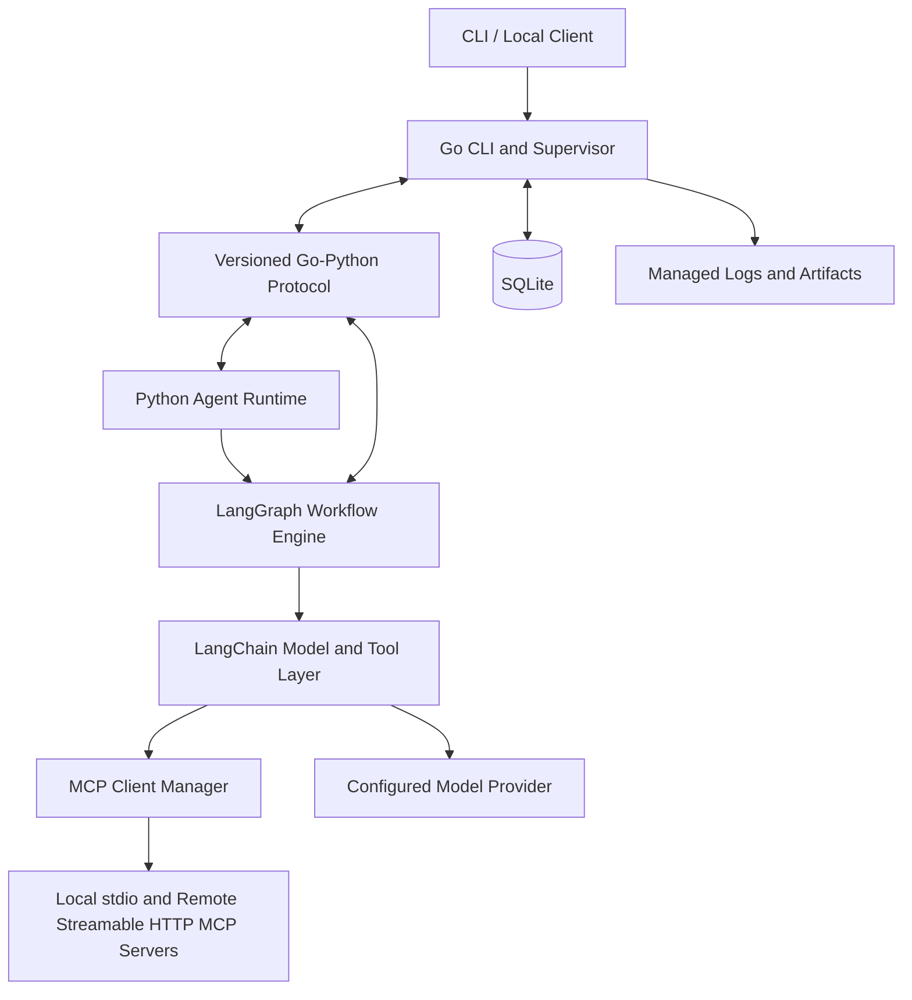
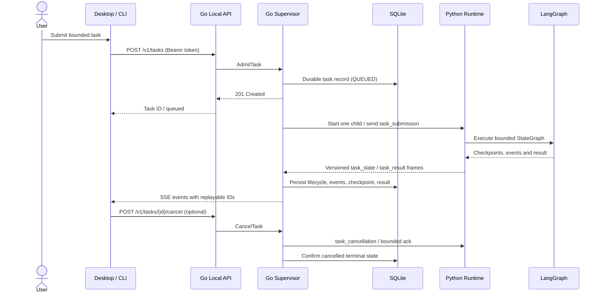

# CRANE — System Architecture

## 1. Purpose

CRANE is a headless, offline-first execution runtime for tasks that interact with software systems through Model Context Protocol (MCP) tools. It coordinates bounded workflows, persists task state, applies action policy, handles failures, and returns concise results.

This document distinguishes:

- **Target architecture:** the intended ownership and runtime design.
- **Current repository implementation:** source modules that exist today.
- **Verified behavior:** behavior demonstrated by tests or end-to-end execution.

A component existing in source is not, by itself, proof that its full integration path works.

## 2. Architectural principles

- Headless and CLI-first; no mandatory dashboard.
- Go owns the executable, process supervision, task lifecycle, and local persistence coordination.
- Python owns agent workflow execution.
- LangGraph provides stateful workflow orchestration.
- LangChain provides model and tool abstractions.
- MCP is the tool integration boundary.
- SQLite is the default local persistence engine.
- Local execution is preferred; hosted providers are explicit optional integrations.
- No silent cloud fallback or unauthorized data egress.
- Risky, sensitive, privilege-changing, destructive, or externally consequential operations require policy authorization.
- Windows is the first target; core logic should remain portable.

## 2.1 Optional desktop client

The desktop workspace is a separate application under `apps/desktop`; it is not part of the execution core and is never required to run CRANE. The client uses Electron for the desktop lifecycle and React/TypeScript for presentation. It communicates only through a narrow preload bridge. It does not access SQLite directly, spawn arbitrary shell commands, or bypass Go-owned policy.

The current client reads real `/v1/health`, `/v1/tasks` and `/v1/tasks/{id}` data, submits tasks through `POST /v1/tasks`, cancels through `POST /v1/tasks/{id}/cancel`, and streams persisted events through authenticated SSE. The Electron main process retrieves the protected installation token through the trusted `agent api-token` command, holds it in memory, and calls only `127.0.0.1:8787`. The preload exposes `getAppInfo`, `getHealth`, `getTasks`, `getTask`, `submitTask`, `cancelTask` and `subscribeTaskEvents`; the renderer never receives the token or arbitrary HTTP, filesystem, or shell access. Disconnected, recovering and error states are reported explicitly; no health, tasks, events or status are fabricated. MCP servers and approvals remain unavailable because the backend API does not expose them. Closing the desktop window must not stop supervisor-owned tasks.

## 3. Target component view



The diagram is the intended logical architecture. The CLI now starts the real supervisor and authenticated loopback API, but the full task execution/recovery path still requires behavioral integration testing.

## 4. Component responsibilities

### 4.1 Go CLI — `cmd/agent`

Intended responsibilities:
- Parse user commands and flags.
- Submit tasks and display task identifiers.
- Retrieve status and results.
- Request cancellation.
- Expose diagnostics without requiring a graphical interface.

Current implementation:
- Default invocation and `serve` start the supervisor and fixed loopback API.
- `api-token` provides trusted retrieval, rotation and permanent revocation of the protected installation token.
- `task create --id ... --input ...` persists a queued task record; raw input is not returned by the API.
- The full task status/result/cancellation command set is still planned.

### 4.2 Go supervisor — `supervisor`

Intended responsibilities:
- Own runtime process lifecycle.
- Coordinate task admission, state transitions, cancellation, and recovery.
- Start and monitor the Python runtime.
- Exchange versioned messages with Python.
- Coordinate policy and approval decisions.
- Keep execution independent of the submitting terminal.

Current implementation:
- `Start`, `IsRunning`, `HealthCheck`, `RuntimeAvailable`, `Stop` and `Close` are wired into the CLI and API health checks.
- `RuntimeAvailable` runs a real bounded `python -m crane.python_runtime --health` probe; `CRANE_PYTHON` and `CRANE_PYTHON_HOME` can select the Python executable and working directory.
- Process restart recovery and full task/process lifecycle behavior must still be demonstrated through real multi-process tests.

### 4.3 Python agent runtime — `crane/python_runtime`

Responsibilities:
- Receive task and runtime messages.
- Execute the workflow engine.
- Maintain typed workflow state.
- Coordinate MCP tool discovery and invocation through the MCP/LangChain integration.
- Emit structured state and result messages to Go.

Current implementation:
- The Go supervisor starts one short-lived `python -m crane.python_runtime --protocol` child per admitted task, bounded to two concurrent tasks and a 60-second task timeout.
- Runtime identity, task submission, cancellation, checkpoints, events, results and errors are exchanged as versioned NDJSON over stdin/stdout; stderr is captured separately and bounded.
- A reproducible Python dependency manifest and packaged Python runtime are not yet present in the repository.

### 4.4 LangGraph workflow engine

The workflow engine is intended to:
- Normalize task input.
- Select an authorized next action.
- Route to approval when policy requires it.
- Invoke a selected MCP tool.
- Evaluate the result and decide whether to continue, retry, or finish.
- Enforce step, time, and retry bounds.
- Persist state at defined checkpoints.

Current implementation:
- A real `StateGraph` workflow engine executes admitted tasks through an async graph with bounded steps, wall-clock time and cancellation checks.
- Typed checkpoints are emitted at graph boundaries, persisted by Go, and passed back to a replacement Python child only when startup recovery decides the checkpoint is safe to resume.
- MCP tool nodes and approval restoration are not connected to the local API; consequential side-effect replay cannot yet be validated against real tools.

### 4.5 LangChain and model providers

LangChain provides the abstraction for:
- Model/provider invocation.
- Tool interfaces and structured outputs.
- Adapting discovered MCP tools into the workflow.

Provider policy:
- Local providers are preferred for offline/private execution.
- Hosted providers must be explicitly configured.
- CRANE must not silently fall back from local inference to a hosted model.
- Provider selection and data-egress authorization must be enforced outside model-generated instructions.

Current implementation:
- MCP-to-LangChain tool adapter code exists but is not exposed by the current task API.
- `CRANE_MODEL_PROVIDER=local` is the default and returns deterministic workflow facts without inventing model output. `CRANE_MODEL_PROVIDER=ollama` uses `langchain_ollama.ChatOllama` with the validated `langchain-ollama==1.1.0` integration; an unsupported, unavailable or misconfigured provider fails explicitly with no fallback.
- Ollama execution first validates configuration, connectivity and the configured model (`CRANE_MODEL`, default `llama3.2:3b`), then invokes `ChatOllama` through the LangGraph worker with a bounded context size (`CRANE_OLLAMA_NUM_CTX`, default `4096`) and configurable timeouts; non-loopback `OLLAMA_HOST` values require explicit `CRANE_ALLOW_REMOTE_OLLAMA` authorization. CRANE never downloads model weights automatically.
- `agent doctor` reports installation, connectivity, configured model, model availability and provider initialization state without task text or credentials.
- Windows validation covered the real dependency, real Ollama preflight/diagnostics, a real `llama3.2:3b` `ChatOllama` invocation through LangGraph and SQLite, invalid-model failure, persisted lifecycle events and authenticated SSE replay. No fallback occurred.

### 4.6 MCP manager — `crane/mcp_runtime`

Intended responsibilities:
- Register, update, enable, disable, and remove MCP servers.
- Support stdio and Streamable HTTP transports.
- Discover tool names and schemas.
- Validate invocation arguments.
- Apply connection and request timeouts.
- Preserve server identity and isolate server failures.
- Route invocations through policy-approved paths.

Current implementation:
- MCP manager, transport, discovery, and LangChain adapter code are present.
- Live local MCP-server integration and transport lifecycle behavior still require end-to-end validation.

### 4.7 SQLite persistence — `persistence`

SQLite is the default single-machine persistence layer. It is intended to store:
- Task metadata and lifecycle state.
- Task events.
- Checkpoint snapshots/references.
- Approval records.
- Migration metadata.

The current Go persistence package includes database initialization, durable admission with duplicate rejection, task IDs, lifecycle transitions, bounded event history, checkpoint storage, terminal results, API-safe `TaskRecord` list/detail reads that omit raw task input, and startup recovery queries. Checkpoint round-tripping and restart recovery policies are covered by supervisor tests; approval records and migration metadata are not implemented.

### 4.8 Versioned protocol — `python_protocol`

The Go/Python boundary uses newline-delimited JSON messages with an explicit protocol version and message type.

Protocol requirements:
- Validate version, type, and required fields at the boundary.
- Bound message size and reject malformed messages safely.
- Keep stdout reserved for protocol messages when running as a child process.
- Send diagnostics to stderr.
- Ensure one reader owns each pipe.
- Avoid blocking the process on an unread pipe.
- Define startup handshake, task submission, task state, approval, cancellation, result, error, and shutdown semantics consistently.

Current protocol version is `0.1.0`. Implemented task message types are `task_submission`, `task_cancellation`, `task_state`, `task_event`, `task_result` and `task_error`, alongside runtime identity, health and legacy command messages. Frames are size-bounded and decoded by one owning reader per pipe; Go never waits for a child before stdout is fully drained.

### 4.9 Local authentication — `localauth`

On Windows, a 256-bit random installation token is protected with DPAPI (`CryptProtectData`/`CryptUnprotectData`) and application entropy. The default state file is `%LOCALAPPDATA%\CRANE\auth\token.json`, with a `~/.crane/auth/token.json` fallback. Retrieval is idempotent; rotation permanently records the old token hash as revoked before installing the replacement; revocation leaves no active token. Corrupt or inaccessible state is never silently replaced. Verification uses constant-time comparison and rejects revoked hashes even after rotation.

### 4.10 Local API — `localapi`

The Go-owned API binds only to `127.0.0.1:8787`; there is no host configuration and no all-interface mode. It reloads protected token state on every request, so CLI rotation or revocation affects a running server immediately. Versioned `/v1` endpoints provide health, task list/detail, durable admission, cancellation and authenticated SSE event replay. Requests use a 1 MiB request bound and a 64 KiB task-input bound, with strict path/query/body validation, consistent `{"data":...}` / `{"error":...}` JSON envelopes, and `nosniff` responses. Health reports supervisor state, Python runtime probe result, persistence health and overall readiness separately.

## 5. Task execution flow

Verified local path (`CRANE_MODEL_PROVIDER=local`):



MCP discovery/invocation and approval routing remain intended graph nodes; the current local API and desktop UI do not expose them. The verified path was exercised with real Go and Python processes on Windows.

## 6. Task lifecycle

Expected lifecycle:

```text
QUEUED -> STARTING -> RUNNING -> SUCCEEDED
                         |       FAILED
                         |       CANCELLED
                         |       WAITING_APPROVAL
                         |              |
                         +--------------+-> RUNNING (after approval)
```

Rules:
- Validate allowed state transitions.
- Persist transitions before reporting them as durable.
- Keep task IDs stable across process restarts.
- Persist concise results and failure summaries.
- Cancellation must propagate to active workflow/tool execution.
- Pending approval must be tied to the exact action and survive restart.

## 7. Checkpointing and recovery

Recovery is a safety-critical property.

Required behavior:
1. Persist workflow state at explicit boundaries.
2. Associate checkpoint state with a stable task ID.
3. On runtime restart, load the latest valid checkpoint from SQLite.
4. Deliver the checkpoint to the new Python process through the protocol.
5. Restore the workflow at a safe continuation point.
6. Do not replay completed consequential operations unless the tool's idempotency semantics make replay safe.
7. Preserve pending approval and require a decision for the same action.
8. Record recovery decisions and ambiguous outcomes for diagnostics.

Do not claim exactly-once execution. External tools may perform a side effect even if CRANE loses the response. Use idempotency keys or operation records where supported; otherwise treat uncertain outcomes as requiring reconciliation.

**Current verification status:** the supervisor persists checkpoints, events and terminal results from real Python subprocess frames, and startup recovery is tested: queued tasks resume, safe running/starting checkpoints resume, ambiguous in-flight work fails with `ambiguous_recovery`, `waiting_approval` is preserved, and unconfirmed cancellation fails with `cancellation_unconfirmed`. Approval restoration and replay prevention against real non-idempotent MCP tools remain unvalidated because those nodes are not connected. See [PROJECT_TRACKER.md](PROJECT_TRACKER.md).

## 8. Security and policy boundary

Tool descriptions and model output are untrusted data. They cannot grant permissions or constitute user approval.

Default policy:
- Harmless read-only actions should not prompt unnecessarily.
- Destructive, sensitive, privilege-changing, execution-capable, and externally consequential actions require explicit authorization by default.
- Approval must bind to the exact action, target, and relevant arguments.
- Any material action change requires new approval.
- Denial prevents invocation.
- Secrets and sensitive arguments must be redacted from logs and diagnostics.

See [SECURITY_AND_PRIVACY.md](SECURITY_AND_PRIVACY.md).

## 9. Process and data layout

Current per-user data root on Windows:

```text
%LOCALAPPDATA%\\CRANE\\
  auth\\
    token.json       # DPAPI-protected blob and revoked token hashes
  crane.db           # SQLite task state
```

On non-Windows hosts the fallback root is `~/.crane/`. The broader `config/`, `logs/`, `artifacts/`, `runtimes/`, `downloads/` and `backups/` layout remains proposed. Executable/runtime files must be separate from user data so updates and uninstall do not erase task history or configuration.

## 10. Current repository map

```text
.
├── apps/desktop/              # Optional Electron + React workspace
├── cmd/agent/                 # Go CLI entry point
├── supervisor/                # Go process/supervisor package
├── localapi/                  # Authenticated loopback API
├── localauth/                 # DPAPI-protected installation token lifecycle
├── persistence/               # SQLite persistence package
├── python_protocol/           # Versioned protocol types and parsing
├── crane/
│   ├── python_runtime/        # Python protocol runtime, provider, workflow engine and state
│   └── mcp_runtime/           # MCP manager and LangChain adapter
└── *.md                       # Product, architecture and engineering docs
```

## 11. Known gaps before production use

- Validate MCP stdio and Streamable HTTP against real local test servers and connect them to the graph through policy.
- Implement and verify exact-action approval persistence, denial, and restart recovery.
- Verify timeout, concurrency saturation and side-effect ambiguity with real external tools.
- Install and validate the pinned Ollama provider dependency against a local model; never fall back implicitly.
- Add a pinned Python dependency manifest, reproducible environment and packaged runtime.
- Complete Windows release acceptance, packaging, signing, update, rollback, and uninstall.

No production installer, official install URL, or Windows release is currently available.
