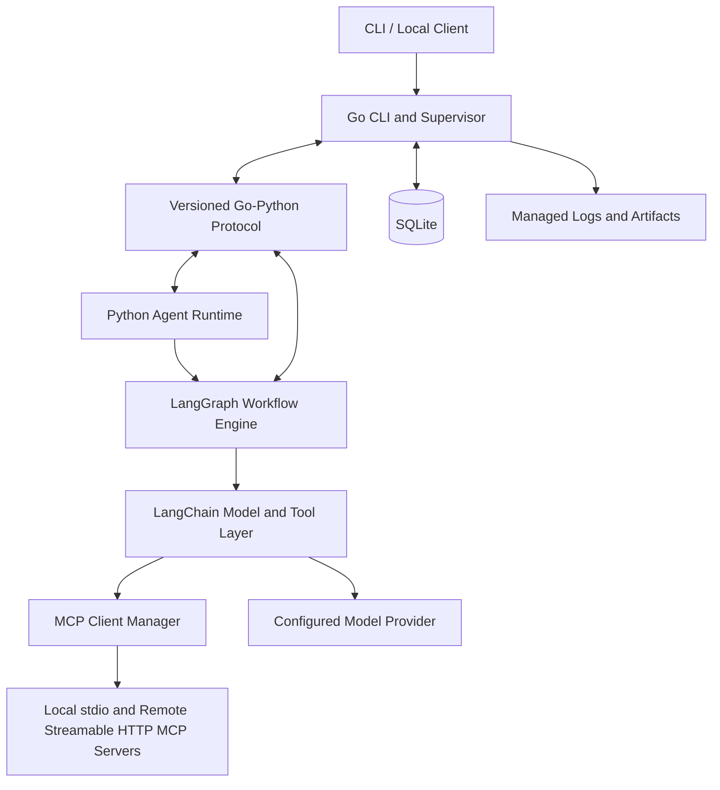
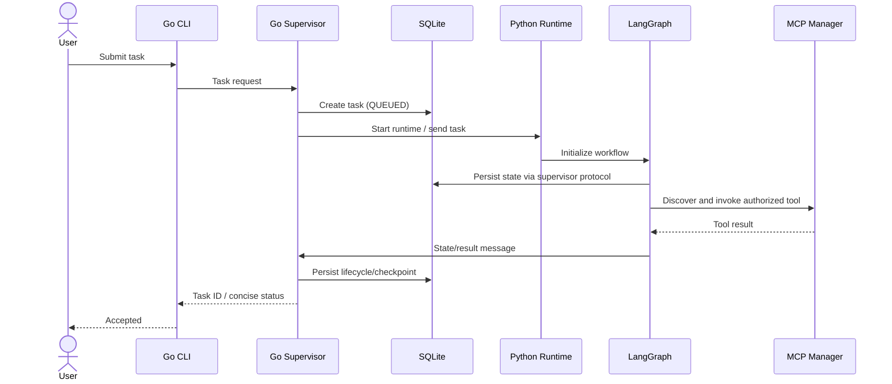

# CRANE — System Architecture

## 1. Purpose

CRANE is a headless, offline-first execution runtime for tasks that interact with software systems through Model Context Protocol (MCP) tools. It coordinates bounded workflows, persists task state, applies action policy, handles failures, and returns concise results.

This document distinguishes:

- **Target architecture:** the intended ownership and runtime design.
- **Current repository implementation:** source modules that exist today.
- **Verified behavior:** behavior demonstrated by tests or end-to-end execution.

A component existing in source is not, by itself, proof that its full integration path works.

## 2. Architectural principles

- Headless and CLI-first; no mandatory dashboard.
- Go owns the executable, process supervision, task lifecycle, and local persistence coordination.
- Python owns agent workflow execution.
- LangGraph provides stateful workflow orchestration.
- LangChain provides model and tool abstractions.
- MCP is the tool integration boundary.
- SQLite is the default local persistence engine.
- Local execution is preferred; hosted providers are explicit optional integrations.
- No silent cloud fallback or unauthorized data egress.
- Risky, sensitive, privilege-changing, destructive, or externally consequential operations require policy authorization.
- Windows is the first target; core logic should remain portable.

## 2.1 Optional desktop client

The desktop workspace is a separate application under `apps/desktop`; it is not part of the execution core and is never required to run CRANE. The initial client uses Electron for the desktop lifecycle and React/TypeScript for presentation. It communicates only through a narrow preload bridge. It must not access SQLite directly, spawn arbitrary shell commands, or bypass Go-owned policy.

The current desktop shell is intentionally disconnected because the supervisor does not yet expose the required authenticated local API. It must display an explicit disconnected state rather than fabricate executions, health, MCP servers or approvals. When the API is implemented, it should be versioned, authenticated, loopback-only by default, and expose task submission, status/results, event streaming, cancellation and approval operations. Closing the desktop window must not stop supervisor-owned tasks.

## 3. Target component view



The diagram is the intended logical architecture. In the current codebase, the CLI entry point is not yet fully wired to the separate supervisor package, and the full task execution/recovery path still requires behavioral integration testing.

## 4. Component responsibilities

### 4.1 Go CLI — `cmd/agent`

Intended responsibilities:
- Parse user commands and flags.
- Submit tasks and display task identifiers.
- Retrieve status and results.
- Request cancellation.
- Expose diagnostics without requiring a graphical interface.

Current implementation:
- A Go entry point exists.
- The development version flag is present.
- The current `main.go` still contains placeholder supervisor lifecycle code; task-oriented commands are not yet a complete CLI.

### 4.2 Go supervisor — `supervisor`

Intended responsibilities:
- Own runtime process lifecycle.
- Coordinate task admission, state transitions, cancellation, and recovery.
- Start and monitor the Python runtime.
- Exchange versioned messages with Python.
- Coordinate policy and approval decisions.
- Keep execution independent of the submitting terminal.

Current implementation:
- A supervisor package and Python process-launch/protocol handling code exist.
- The package is not yet fully integrated into the CLI entry point.
- Process restart recovery must be demonstrated through a real multi-process test before being considered verified.

### 4.3 Python agent runtime — `crane/python_runtime`

Responsibilities:
- Receive task and runtime messages.
- Execute the workflow engine.
- Maintain typed workflow state.
- Coordinate MCP tool discovery and invocation through the MCP/LangChain integration.
- Emit structured state and result messages to Go.

Current implementation:
- Runtime, CLI, workflow engine, and workflow state modules exist.
- A reproducible Python dependency manifest and packaged Python runtime are not yet present in the repository.

### 4.4 LangGraph workflow engine

The workflow engine is intended to:
- Normalize task input.
- Select an authorized next action.
- Route to approval when policy requires it.
- Invoke a selected MCP tool.
- Evaluate the result and decide whether to continue, retry, or finish.
- Enforce step, time, and retry bounds.
- Persist state at defined checkpoints.

Current implementation:
- A `StateGraph` workflow engine and typed workflow state are present.
- Correct behavior across process termination, approval restoration, and consequential side effects remains an integration-test requirement.

### 4.5 LangChain and model providers

LangChain provides the abstraction for:
- Model/provider invocation.
- Tool interfaces and structured outputs.
- Adapting discovered MCP tools into the workflow.

Provider policy:
- Local providers are preferred for offline/private execution.
- Hosted providers must be explicitly configured.
- CRANE must not silently fall back from local inference to a hosted model.
- Provider selection and data-egress authorization must be enforced outside model-generated instructions.

Current implementation:
- MCP-to-LangChain tool adapter code exists.
- A complete provider configuration layer and Ollama integration are not yet present.

### 4.6 MCP manager — `crane/mcp_runtime`

Intended responsibilities:
- Register, update, enable, disable, and remove MCP servers.
- Support stdio and Streamable HTTP transports.
- Discover tool names and schemas.
- Validate invocation arguments.
- Apply connection and request timeouts.
- Preserve server identity and isolate server failures.
- Route invocations through policy-approved paths.

Current implementation:
- MCP manager, transport, discovery, and LangChain adapter code are present.
- Live local MCP-server integration and transport lifecycle behavior still require end-to-end validation.

### 4.7 SQLite persistence — `persistence`

SQLite is the default single-machine persistence layer. It is intended to store:
- Task metadata and lifecycle state.
- Task events.
- Checkpoint snapshots/references.
- Approval records.
- Migration metadata.

The current Go persistence package includes database initialization and task/checkpoint-related storage methods. Correct transaction semantics, checkpoint round-tripping, restart restoration, and concurrent access must be covered by behavioral tests.

### 4.8 Versioned protocol — `python_protocol`

The Go/Python boundary uses newline-delimited JSON messages with an explicit protocol version and message type.

Protocol requirements:
- Validate version, type, and required fields at the boundary.
- Bound message size and reject malformed messages safely.
- Keep stdout reserved for protocol messages when running as a child process.
- Send diagnostics to stderr.
- Ensure one reader owns each pipe.
- Avoid blocking the process on an unread pipe.
- Define startup handshake, task submission, task state, approval, cancellation, result, error, and shutdown semantics consistently.

## 5. Task execution flow

Target flow:



The sequence is a design target. The full path must be exercised with real Go and Python processes before it can be described as verified.

## 6. Task lifecycle

Expected lifecycle:

```text
QUEUED -> STARTING -> RUNNING -> SUCCEEDED
                         |       FAILED
                         |       CANCELLED
                         |       WAITING_APPROVAL
                         |              |
                         +--------------+-> RUNNING (after approval)
```

Rules:
- Validate allowed state transitions.
- Persist transitions before reporting them as durable.
- Keep task IDs stable across process restarts.
- Persist concise results and failure summaries.
- Cancellation must propagate to active workflow/tool execution.
- Pending approval must be tied to the exact action and survive restart.

## 7. Checkpointing and recovery

Recovery is a safety-critical property.

Required behavior:
1. Persist workflow state at explicit boundaries.
2. Associate checkpoint state with a stable task ID.
3. On runtime restart, load the latest valid checkpoint from SQLite.
4. Deliver the checkpoint to the new Python process through the protocol.
5. Restore the workflow at a safe continuation point.
6. Do not replay completed consequential operations unless the tool's idempotency semantics make replay safe.
7. Preserve pending approval and require a decision for the same action.
8. Record recovery decisions and ambiguous outcomes for diagnostics.

Do not claim exactly-once execution. External tools may perform a side effect even if CRANE loses the response. Use idempotency keys or operation records where supported; otherwise treat uncertain outcomes as requiring reconciliation.

**Current verification status:** checkpoint message types, Python state serialization, and Go persistence code exist. A full separate-process test proving checkpoint writes, process termination, restoration, approval recovery, and replay prevention is still required. See [PROJECT_TRACKER.md](PROJECT_TRACKER.md).

## 8. Security and policy boundary

Tool descriptions and model output are untrusted data. They cannot grant permissions or constitute user approval.

Default policy:
- Harmless read-only actions should not prompt unnecessarily.
- Destructive, sensitive, privilege-changing, execution-capable, and externally consequential actions require explicit authorization by default.
- Approval must bind to the exact action, target, and relevant arguments.
- Any material action change requires new approval.
- Denial prevents invocation.
- Secrets and sensitive arguments must be redacted from logs and diagnostics.

See [SECURITY_AND_PRIVACY.md](SECURITY_AND_PRIVACY.md).

## 9. Process and data layout

Proposed per-user data root on Windows:

```text
%LOCALAPPDATA%\\CRANE\\
  config/
  data/
    crane.db
  logs/
  artifacts/
  runtimes/
  downloads/
  backups/
```

Executable/runtime files must be separate from user data so updates and uninstall do not erase task history or configuration.

## 10. Current repository map

```text
.
├── cmd/agent/                 # Go CLI entry point
├── supervisor/                # Go process/supervisor package
├── persistence/               # SQLite persistence package
├── python_protocol/           # Versioned protocol types and parsing
├── crane/
│   ├── python_runtime/        # Python runtime, workflow engine and state
│   └── mcp_runtime/           # MCP manager and LangChain adapter
└── *.md                       # Product, architecture and engineering docs
```

## 11. Known gaps before production use

- Wire the actual Go supervisor into the CLI.
- Correct and validate Go/Python package imports after repository restructuring.
- Add a pinned Python dependency manifest and reproducible environment.
- Prove protocol handshake and bidirectional messages with subprocess tests.
- Prove durable restart recovery against the same SQLite database.
- Validate MCP stdio and Streamable HTTP against real local test servers.
- Verify approval, cancellation, timeout, and uncertain side-effect handling.
- Implement explicit model-provider configuration and Ollama integration.
- Complete Windows acceptance, packaging, signing, update, rollback, and uninstall.

No production installer, official install URL, or Windows release is currently available.
