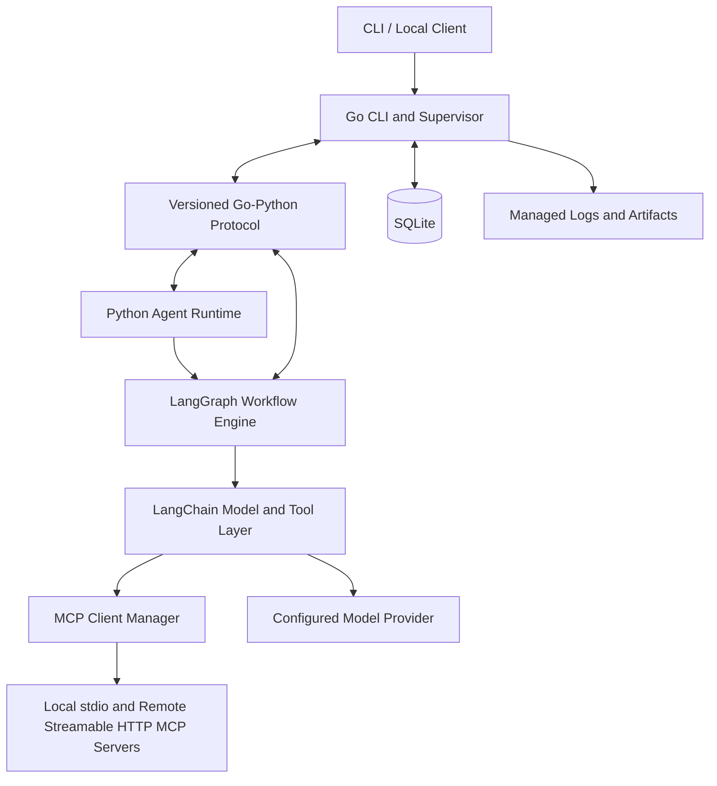
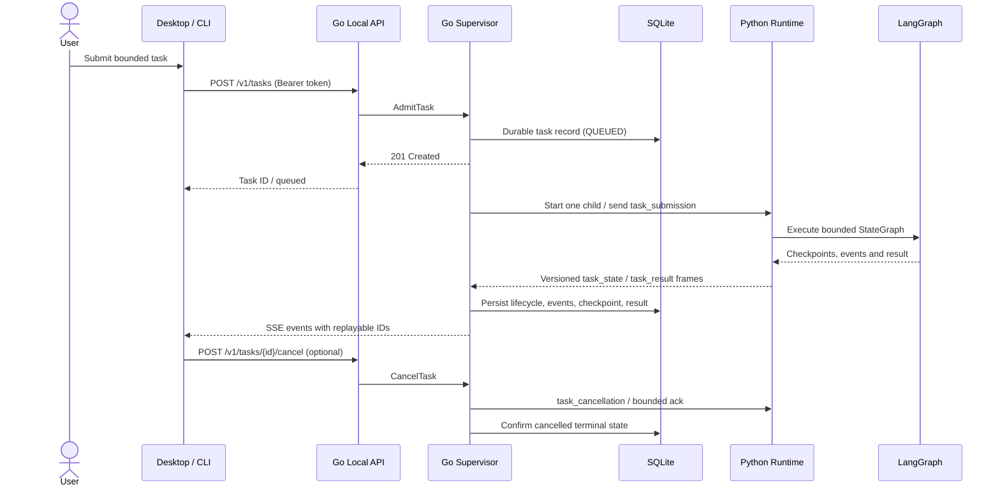

# CRANE — System Architecture

## 1. Purpose

CRANE is a headless, offline-first execution runtime for tasks that interact with software systems through Model Context Protocol (MCP) tools. It coordinates bounded workflows, persists task state, applies action policy, handles failures, and returns concise results.

This document distinguishes:

- **Target architecture:** the intended ownership and runtime design.
- **Current repository implementation:** source modules that exist today.
- **Verified behavior:** behavior demonstrated by tests or end-to-end execution.

A component existing in source is not, by itself, proof that its full integration path works.

## 2. Architectural principles

- Headless and CLI-first; no mandatory dashboard.
- Go owns the executable, process supervision, task lifecycle, and local persistence coordination.
- Python owns agent workflow execution.
- LangGraph provides stateful workflow orchestration.
- LangChain provides model and tool abstractions.
- MCP is the tool integration boundary.
- SQLite is the default local persistence engine.
- Local execution is preferred; hosted providers are explicit optional integrations.
- No silent cloud fallback or unauthorized data egress.
- Risky, sensitive, privilege-changing, destructive, or externally consequential operations require policy authorization.
- Windows is the first target; core logic should remain portable.

## 2.1 Optional desktop client

The desktop workspace is a separate application under `apps/desktop`; it is not part of the execution core and is never required to run CRANE. The client uses Electron for the desktop lifecycle and React/TypeScript for presentation. It communicates only through a narrow preload bridge. It does not access SQLite directly, spawn arbitrary shell commands, or bypass Go-owned policy.

The current client reads real `/v1/health`, `/v1/tasks` and `/v1/tasks/{id}` data, submits tasks through `POST /v1/tasks`, cancels through `POST /v1/tasks/{id}/cancel`, and streams persisted events through authenticated SSE. The Electron main process retrieves the protected installation token through the trusted `agent api-token` command, holds it in memory, and calls only `127.0.0.1:8787`. The preload exposes `getAppInfo`, `getHealth`, `getTasks`, `getTask`, `submitTask`, `cancelTask` and `subscribeTaskEvents`; the renderer never receives the token or arbitrary HTTP, filesystem, or shell access. Disconnected, recovering and error states are reported explicitly; no health, tasks, events or status are fabricated. MCP management and approval routes are exposed by the authenticated loopback API, but the desktop renderer does not yet provide MCP management screens. Closing the desktop window must not stop supervisor-owned tasks.

## 3. Target component view



The diagram reflects the implemented logical architecture. The CLI starts the real supervisor, MCP daemon controller and authenticated loopback API. Task execution, MCP discovery/invocation, approval gating and recovery behavior are covered by real local integration tests. A reproducible unsigned Windows release build and an isolated lifecycle acceptance harness are also implemented; clean-machine and signed-release acceptance remain separate.

## 4. Component responsibilities

### 4.1 Go CLI — `cmd/agent`

Intended responsibilities:
- Parse user commands and flags.
- Submit tasks and display task identifiers.
- Retrieve status and results.
- Request cancellation.
- Expose diagnostics without requiring a graphical interface.

Current implementation:
- Default invocation and `serve` start the supervisor and fixed loopback API.
- `api-token` provides trusted retrieval, rotation and permanent revocation of the protected installation token.
- `task create --id ... --input ...` persists a queued task record; raw input is not returned by the API.
- `run`, `status`, `result`, and `cancel` provide the durable task command set; `doctor` reports real runtime, SQLite, MCP, Ollama, and installation health.
- `update` and `uninstall` invoke verified, detached PowerShell lifecycle scripts from a packaged installation.

### 4.2 Go supervisor — `supervisor`

Intended responsibilities:
- Own runtime process lifecycle.
- Coordinate task admission, state transitions, cancellation, and recovery.
- Start and monitor the Python runtime.
- Exchange versioned messages with Python.
- Coordinate policy and approval decisions.
- Keep execution independent of the submitting terminal.

Current implementation:
- `Start`, `IsRunning`, `HealthCheck`, `RuntimeAvailable`, `Stop` and `Close` are wired into the CLI and API health checks.
- `RuntimeAvailable` runs a real bounded `python -m crane.python_runtime --health` probe; `CRANE_PYTHON` and `CRANE_PYTHON_HOME` can select the Python executable and working directory.
- The supervisor owns a long-lived Python MCP daemon, forwards enabled MCP server configurations and exact durable approval grants in `task_submission`, and persists `tool_result` frames from both the daemon and task children.
- Process restart recovery and task lifecycle behavior are covered by real multi-process Go tests.

### 4.3 Python agent runtime — `crane/python_runtime`

Responsibilities:
- Receive task and runtime messages.
- Execute the workflow engine.
- Maintain typed workflow state.
- Coordinate MCP tool discovery and invocation through the MCP/LangChain integration.
- Emit structured state and result messages to Go.

Current implementation:
- The Go supervisor starts one short-lived `python -m crane.python_runtime --protocol` child per admitted task, bounded to two concurrent tasks and a 180-second task timeout.
- Runtime identity, task submission, cancellation, checkpoints, events, results, MCP commands and errors are exchanged as versioned NDJSON over stdin/stdout; stderr is captured separately and bounded.
- Task submissions carry private MCP server configurations and durable approval fingerprints; environment values are never written to task events, checkpoints or API responses.
- `requirements.lock.txt` pins the production dependency closure with SHA-256 hashes. `scripts/build-release.ps1` packages CPython 3.12.7 with the CRANE app under `runtime\`, and the installer independently verifies packaged health and imports before activating a version.

### 4.4 LangGraph workflow engine

The workflow engine is intended to:
- Normalize task input.
- Select an authorized next action.
- Route to approval when policy requires it.
- Invoke a selected MCP tool.
- Evaluate the result and decide whether to continue, retry, or finish.
- Enforce step, time, and retry bounds.
- Persist state at defined checkpoints.

Current implementation:
- A real `StateGraph` workflow engine executes admitted tasks through an async graph with bounded steps, wall-clock time and cancellation checks.
- Typed checkpoints are emitted at graph boundaries, persisted by Go, and passed back to a replacement Python child only when startup recovery decides the checkpoint is safe to resume.
- The execute node discovers MCP tools, converts them through LangChain adapters, and calls a bounded local Ollama tool loop when a tool-capable model is configured.
- Consequential tools are blocked unless an exact durable approval fingerprint matches the attempted action; blocked and approved outcomes are emitted as durable `tool_result` frames.
- Read-only and consequential tool behavior is tested against a real local MCP server; restart-time replay of non-idempotent tool effects remains outside the verified path.

### 4.5 LangChain and model providers

LangChain provides the abstraction for:
- Model/provider invocation.
- Tool interfaces and structured outputs.
- Adapting discovered MCP tools into the workflow.

Provider policy:
- Local providers are preferred for offline/private execution.
- Hosted providers must be explicitly configured.
- CRANE must not silently fall back from local inference to a hosted model.
- Provider selection and data-egress authorization must be enforced outside model-generated instructions.

Current implementation:
- Discovered MCP tools are converted with `langchain-mcp-adapters==0.3.2` and invoked through a CRANE policy interceptor; the adapter never bypasses policy or persistence.
- `CRANE_MODEL_PROVIDER=local` is the default and returns deterministic workflow facts without inventing model output. `CRANE_MODEL_PROVIDER=ollama` uses `langchain_ollama.ChatOllama` with the validated `langchain-ollama==1.1.0` integration; an unsupported, unavailable or misconfigured provider fails explicitly with no fallback.
- Ollama execution first validates configuration, connectivity and the configured model (`CRANE_MODEL`, default `llama3.2:3b`), then invokes `ChatOllama` through the LangGraph worker with a bounded context size (`CRANE_OLLAMA_NUM_CTX`, default `4096`) and configurable timeouts; non-loopback `OLLAMA_HOST` values require explicit `CRANE_ALLOW_REMOTE_OLLAMA` authorization. CRANE never downloads model weights automatically.
- With MCP tools present, Ollama uses a bounded tool loop (`bind_tools`, real tool invocations, tool-result messages, at most four rounds) and returns only the model's final answer grounded in those results.
- `agent doctor` reports installation, connectivity, configured model, model availability and provider initialization state without task text or credentials.
- Windows validation covered the real dependency, real Ollama preflight/diagnostics, a real `llama3.2:3b` `ChatOllama` invocation through LangGraph and SQLite, invalid-model failure, persisted lifecycle events, authenticated SSE replay, and a real Ollama-to-MCP tool invocation. No fallback occurred.

### 4.6 MCP manager — `crane/mcp_runtime`

Intended responsibilities:
- Register, update, enable, disable, and remove MCP servers.
- Support stdio and Streamable HTTP transports.
- Discover tool names and schemas.
- Validate invocation arguments.
- Apply connection and request timeouts.
- Preserve server identity and isolate server failures.
- Route invocations through policy-approved paths.

Current implementation:
- The Python SDK owns real stdio and Streamable HTTP sessions with explicit initialize, paginated tool discovery, JSON Schema validation, bounded invocations and same-task shutdown.
- Tool trust is derived from static annotations and safe names only; descriptions and model output cannot grant permission.
- Stdio executables are allowlisted, inline-code arguments are rejected, environment keys are constrained, and environment values remain private to the process boundary.
- Real local MCP servers are exercised for success, policy block, exact approval grant, both transports, and task-submission integration.

### 4.7 SQLite persistence — `persistence`

SQLite is the default single-machine persistence layer. It is intended to store:
- Task metadata and lifecycle state.
- Task events.
- Checkpoint snapshots/references.
- Approval records.
- Migration metadata.

The current Go persistence package includes database initialization, durable admission with duplicate rejection, task IDs, lifecycle transitions, bounded event history, checkpoint storage, terminal results, API-safe `TaskRecord` list/detail reads that omit raw task input, and startup recovery queries. It also stores MCP server configurations, discovered tools/schemas, invocation records with redacted arguments/results, exact-action approval requests and decisions. Checkpoint round-tripping, restart recovery policies and MCP/approval persistence are covered by Go tests; migration metadata is not implemented.

### 4.8 Versioned protocol — `python_protocol`

The Go/Python boundary uses newline-delimited JSON messages with an explicit protocol version and message type.

Protocol requirements:
- Validate version, type, and required fields at the boundary.
- Bound message size and reject malformed messages safely.
- Keep stdout reserved for protocol messages when running as a child process.
- Send diagnostics to stderr.
- Ensure one reader owns each pipe.
- Avoid blocking the process on an unread pipe.
- Define startup handshake, task submission, task state, approval, cancellation, result, error, and shutdown semantics consistently.

Current protocol version is `0.1.0`. Implemented task message types are `task_submission`, `task_cancellation`, `task_state`, `task_event`, `task_result`, `task_error` and `tool_result`, alongside runtime identity, health, `mcp_command` and `mcp_response`. Task submissions carry private MCP configurations and durable approval fingerprints. Frames are size-bounded and decoded by one owning reader per pipe; Go never waits for a child before stdout is fully drained.

### 4.9 Local authentication — `localauth`

On Windows, a 256-bit random installation token is protected with DPAPI (`CryptProtectData`/`CryptUnprotectData`) and application entropy. The default state file is `%LOCALAPPDATA%\CRANE\auth\token.json`, with a `~/.crane/auth/token.json` fallback. Retrieval is idempotent; rotation permanently records the old token hash as revoked before installing the replacement; revocation leaves no active token. Corrupt or inaccessible state is never silently replaced. Verification uses constant-time comparison and rejects revoked hashes even after rotation.

### 4.10 Local API — `localapi`

The Go-owned API binds only to `127.0.0.1:8787`; there is no host configuration and no all-interface mode. It reloads protected token state on every request, so CLI rotation or revocation affects a running server immediately. Versioned `/v1` endpoints provide health, task list/detail, durable admission, cancellation, authenticated SSE event replay, and MCP status/server/connect/disconnect/discover/tools/invoke/invocations/approvals management. MCP responses expose environment key names only, never values. Requests use a 1 MiB request bound and a 64 KiB task-input bound, with strict path/query/body validation, consistent `{"data":...}` / `{"error":...}` JSON envelopes, and `nosniff` responses. Health reports supervisor state, Python runtime probe result, persistence health and overall readiness separately.

## 5. Task execution flow

Verified local path (`CRANE_MODEL_PROVIDER=local`):



With MCP servers configured, the supervisor injects their private configurations and durable approval grants into the task submission. The Python graph connects real MCP sessions, converts tools through LangChain, and lets the configured local Ollama model invoke them. Each invocation is policy checked, persisted and emitted as a `tool_result` frame. Consequential actions remain blocked until an exact approval is granted through the authenticated API. The verified path was exercised with real Go and Python processes on Windows, including a real `llama3.2:3b` Ollama tool call to a local MCP server.

## 6. Task lifecycle

Expected lifecycle:

```text
QUEUED -> STARTING -> RUNNING -> SUCCEEDED
                         |       FAILED
                         |       CANCELLED
                         |       WAITING_APPROVAL
                         |              |
                         +--------------+-> RUNNING (after approval)
```

Rules:
- Validate allowed state transitions.
- Persist transitions before reporting them as durable.
- Keep task IDs stable across process restarts.
- Persist concise results and failure summaries.
- Cancellation must propagate to active workflow/tool execution.
- Pending approval must be tied to the exact action and survive restart.

## 7. Checkpointing and recovery

Recovery is a safety-critical property.

Required behavior:
1. Persist workflow state at explicit boundaries.
2. Associate checkpoint state with a stable task ID.
3. On runtime restart, load the latest valid checkpoint from SQLite.
4. Deliver the checkpoint to the new Python process through the protocol.
5. Restore the workflow at a safe continuation point.
6. Do not replay completed consequential operations unless the tool's idempotency semantics make replay safe.
7. Preserve pending approval and require a decision for the same action.
8. Record recovery decisions and ambiguous outcomes for diagnostics.

Do not claim exactly-once execution. External tools may perform a side effect even if CRANE loses the response. Use idempotency keys or operation records where supported; otherwise treat uncertain outcomes as requiring reconciliation.

**Current verification status:** the supervisor persists checkpoints, events and terminal results from real Python subprocess frames, and startup recovery is tested: queued tasks resume, safe running/starting checkpoints resume, ambiguous in-flight work fails with `ambiguous_recovery`, `waiting_approval` is preserved, and unconfirmed cancellation fails with `cancellation_unconfirmed`. Exact-action approval records and grants are persisted and enforced against real MCP tools, including block-then-approve-then-invoke. Restart-time replay prevention for already executed non-idempotent tool effects remains unvalidated. See [PROJECT_TRACKER.md](PROJECT_TRACKER.md).

## 8. Security and policy boundary

Tool descriptions and model output are untrusted data. They cannot grant permissions or constitute user approval.

Default policy:
- Harmless read-only actions should not prompt unnecessarily.
- Destructive, sensitive, privilege-changing, execution-capable, and externally consequential actions require explicit authorization by default.
- Approval must bind to the exact action, target, and relevant arguments.
- Any material action change requires new approval.
- Denial prevents invocation.
- Secrets and sensitive arguments must be redacted from logs and diagnostics.

See [SECURITY_AND_PRIVACY.md](SECURITY_AND_PRIVACY.md).

## 9. Process, installation, and data layout

Packaged Windows installation root (separate from user data):

```text
%LOCALAPPDATA%\\Programs\\CRANE\\
  bin\\agent.cmd                  # stable launcher
  bin\\install.ps1
  bin\\uninstall.ps1
  versions\\<version>\\agent.exe
  versions\\<version>\\runtime\\python\\
  versions\\<version>\\runtime\\app\\
  current.txt                     # active version pointer
  previous.txt                    # rollback pointer
  staging\\                       # transient verified update work
```

Per-user data root on Windows:

```text
%LOCALAPPDATA%\\CRANE\\
  config\\
  data\\crane.db                  # SQLite task state
  auth\\token.json                # DPAPI-protected blob and revoked token hashes
  logs\\
  mcp\\
  tmp\\
  cache\\
```

On non-Windows hosts the fallback data root is `~/.crane/`. Updates and uninstall operate only on the installation root; user data is preserved by default. This separation is verified by the isolated Windows acceptance harness.

## 10. Current repository map

```text
.
├── apps/desktop/              # Optional Electron + React workspace
├── cmd/agent/                 # Go CLI entry point
├── supervisor/                # Go process/supervisor package
├── localapi/                  # Authenticated loopback API
├── localauth/                 # DPAPI-protected installation token lifecycle
├── persistence/               # SQLite persistence package
├── python_protocol/           # Versioned protocol types and parsing
├── crane/
│   ├── python_runtime/        # Python protocol runtime, provider, workflow engine and state
│   └── mcp_runtime/           # MCP manager and LangChain adapter
└── *.md                       # Product, architecture and engineering docs
```

## 11. Known gaps before production use

- Verify approval denial and restart-time replay prevention against real non-idempotent MCP tools.
- Verify timeout, concurrency saturation and side-effect ambiguity with real external tools.
- Validate the packaged installation on clean Windows 10 and Windows 11 x64 machines and with PowerShell 7.
- Sign the manifest and executable with a real certificate; current release metadata is explicitly unsigned/unverified.
- Define a controlled official release host and install command; the release source is currently configurable only.
- Test database migration compatibility across packaged upgrades.

An unsigned PowerShell installer, private Python runtime, update/rollback/uninstall lifecycle, and an isolated Windows acceptance harness are implemented. No official install URL, signed release, or clean-machine acceptance is currently available.
