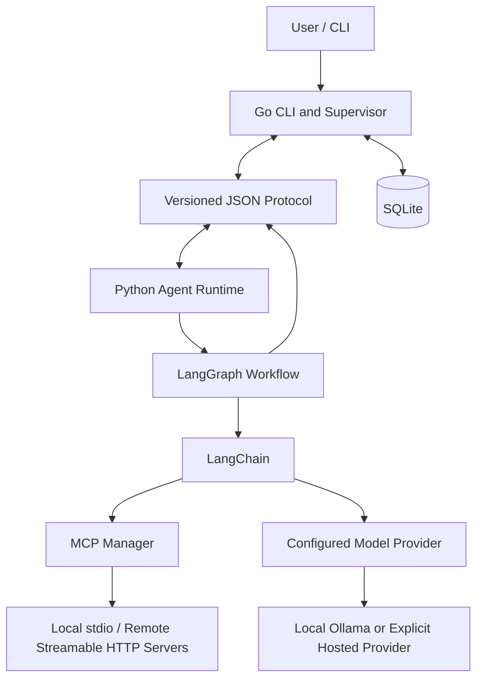

# CRANE

**A headless, offline-first runtime for executing and orchestrating MCP-powered tasks.**

CRANE is designed to accept a task, coordinate authorized tools, run a bounded workflow, persist execution state, handle failures, and return a concise result. It is intended to be a local-first execution layer—not a chatbot, RAG product, or dashboard.

> **Project status: early implementation / not production-ready.** The repository contains Go supervisor and persistence packages, a Python runtime, MCP integration code, and a LangGraph workflow engine. The command-line entry point and several cross-process flows are still incomplete. Durable recovery, approval enforcement, Windows behavior, and release packaging must not be considered production-verified yet.

## What CRANE is being built to do

- Run headlessly through a CLI and local interfaces.
- Execute workflows using **LangGraph**, with **LangChain** for model and tool abstractions.
- Connect to local and remote tools through **MCP**.
- Persist task and checkpoint data locally with **SQLite**.
- Prefer local inference and local tools when available.
- Require explicit policy authorization for risky or externally consequential actions.
- Continue eligible work after the submitting terminal disconnects.
- Recover safely after runtime interruption without blindly replaying uncertain side effects.

## Architecture at a glance

The intended ownership boundary is Go for process/task coordination and Python for agent execution:



This diagram describes the intended component boundaries. It does not imply that every path is already wired end to end. See [ARCHITECTURE.md](ARCHITECTURE.md) for component responsibilities, data flow, lifecycle, and known integration gaps.

## Repository layout

```text
.
├── cmd/agent/              # Go CLI entry point
├── supervisor/             # Go runtime/process coordination
├── persistence/            # SQLite store and task/checkpoint persistence
├── python_protocol/        # Versioned Go/Python message definitions
├── crane/
│   ├── python_runtime/     # Python runtime and LangGraph workflow engine
│   └── mcp_runtime/        # MCP manager and LangChain tool adapter
├── AGENTS.md               # Repository instructions for coding agents
├── ARCHITECTURE.md         # System architecture and boundaries
├── PRODUCT_REQUIREMENTS.md # Product scope and requirements
├── TECHNICAL_SPECIFICATION.md
├── SECURITY_AND_PRIVACY.md
├── WINDOWS_ACCEPTANCE_TESTS.md
└── ...
```

## Implementation snapshot

| Component | Present in repository | Current confidence |
|---|---:|---|
| Go CLI entry point | Yes | Basic version flag; supervisor wiring is incomplete |
| Go supervisor | Yes | Implementation exists; process lifecycle needs end-to-end validation |
| SQLite persistence | Yes | Store and checkpoint methods exist; restart recovery is not yet proven end to end |
| Go/Python protocol | Yes | Versioned message structures exist; full protocol behavior needs integration tests |
| Python runtime | Yes | Runtime modules exist; packaged runtime is not available |
| MCP integration | Yes | Manager, transports, discovery and adapter code exist; live-server behavior needs validation |
| LangChain adapter | Yes | Present in MCP runtime code; provider configuration is incomplete |
| LangGraph workflow | Yes | Workflow engine and typed state exist; full execution/recovery guarantees are unverified |
| Ollama provider | Not yet integrated | Planned |
| Installer / signed releases | No | Not available |
| Production Windows release | No | Acceptance testing and packaging remain |

Do not interpret source presence or a passing unit test as proof of a complete production workflow. The current known integration and validation gaps are tracked in [PROJECT_TRACKER.md](PROJECT_TRACKER.md).

## Current development state

The project has established its initial Go/Python architecture and implementation modules. The next engineering work should prioritize correctness at the boundaries:

1. Wire the CLI to the real supervisor rather than placeholder lifecycle code.
2. Validate the Go/Python protocol in a real subprocess.
3. Prove SQLite checkpoint persistence and process-restart restoration with a behavioral integration test.
4. Validate MCP connections and tool invocation against local test servers.
5. Verify approval, cancellation, timeout, and side-effect recovery behavior.
6. Add and validate local model-provider integration (Ollama) only after the runtime path is reliable.
7. Package and test the complete application on Windows before calling it installable.

## Build and validation

The Go module is at the repository root. A Go toolchain matching the version declared in `go.mod` is required for Go development.

Useful checks for contributors:

```powershell
go version
go build ./...
go vet ./...
go test ./...
```

These are validation commands, not a claim that the current repository passes them. Run them on the current checkout and report their actual results. Python dependencies are not yet documented in a committed lock/requirements file, so a reproducible Python installation workflow is still outstanding.

The current executable supports a development version query:

```powershell
go run ./cmd/agent --version
```

The full task-oriented CLI contract is still under development. Do not treat proposed commands in the technical specification as implemented commands.

## Platform and privacy

- **Initial target:** Windows 10/11 x64.
- **Current status:** Windows-first design; production Windows acceptance is not complete.
- Local model and MCP operation is the intended offline path.
- Hosted model providers and remote MCP servers must be explicitly configured.
- CRANE must never silently fall back to a hosted model or send local data to a remote service without authorization.
- Model weights are not intended to be bundled with the base application.

## Documentation

| Document | Purpose |
|---|---|
| [ARCHITECTURE.md](ARCHITECTURE.md) | Components, ownership, execution flow, and recovery design |
| [PRODUCT_REQUIREMENTS.md](PRODUCT_REQUIREMENTS.md) | Product definition, user journeys, and requirements |
| [TECHNICAL_SPECIFICATION.md](TECHNICAL_SPECIFICATION.md) | Technology choices, protocol, CLI contract, and runtime constraints |
| [SECURITY_AND_PRIVACY.md](SECURITY_AND_PRIVACY.md) | Trust boundaries, permissions, approvals, and data egress |
| [DECISIONS.md](DECISIONS.md) | Recorded architecture decisions |
| [PROJECT_TRACKER.md](PROJECT_TRACKER.md) | Evidence-based implementation status and blockers |
| [WINDOWS_ACCEPTANCE_TESTS.md](WINDOWS_ACCEPTANCE_TESTS.md) | Windows release acceptance criteria |
| [DISTRIBUTION_AND_INSTALLATION.md](DISTRIBUTION_AND_INSTALLATION.md) | Planned installer, updates, rollback, and uninstall |
| [DEVELOPMENT_RULES.md](DEVELOPMENT_RULES.md) | Engineering and validation rules |
| [CONTRIBUTING.md](CONTRIBUTING.md) | Contribution workflow |

## Optional desktop workspace\n\nAn optional Windows-first desktop client now lives in [`apps/desktop`](apps/desktop). It is an Electron + React application, kept separate from the Go/Python runtime so the CLI remains independently usable. The current commit provides the secure desktop shell and local-first interface; live task submission, status streaming, MCP management and approvals remain unavailable until the Go supervisor exposes the versioned authenticated loopback API. The client does not fabricate runtime state. See the [desktop README](apps/desktop/README.md) for setup and current limits.\n\n## Contributing

Read [AGENTS.md](AGENTS.md), [DEVELOPMENT_RULES.md](DEVELOPMENT_RULES.md), and the relevant architecture/product documents before changing code. Keep changes focused, validate the behavior actually changed, preserve user data, and never claim unrun tests or unverified platform support.

## License

See [LICENSE](LICENSE).
