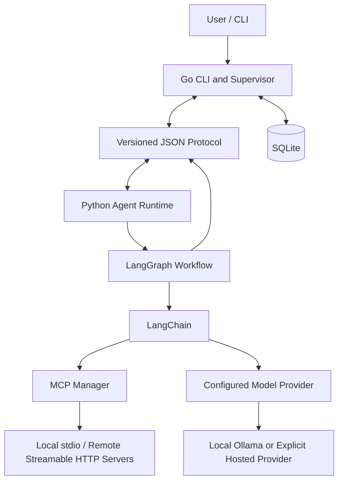

<div align="center">
  
</div>

<p align="center"><strong>CRANE</strong> is a headless, offline-first MCP execution and orchestration runtime for durable, multi-step tasks.</p>

CRANE accepts a task, coordinates authorized tools, runs a bounded workflow, persists execution state, handles failures, and returns a concise result. It is a local-first execution layer—not a chatbot, RAG product, or dashboard.

> **Project status: working vertical slice, not production-ready.** The Go supervisor durably admits tasks, runs bounded Python/LangGraph workflows, confirms cancellation, persists lifecycle/events/checkpoints/results, and streams real events over authenticated SSE. The optional desktop client submits and cancels tasks through the same restricted main-process bridge. Default execution is offline deterministic local mode; Ollama is explicit and only its unavailable-provider failure path was validated in this checkout. MCP server lifecycle, approval enforcement, packaged Python, signed packaging, and release readiness remain unverified.

## What CRANE is being built to do

- Run headlessly through a CLI and local interfaces.
- Execute workflows using **LangGraph**, with **LangChain** for model and tool abstractions.
- Connect to local and remote tools through **MCP**.
- Persist task and checkpoint data locally with **SQLite**.
- Prefer local inference and local tools when available.
- Require explicit policy authorization for risky or externally consequential actions.
- Continue eligible work after the submitting terminal disconnects.
- Recover safely after runtime interruption without blindly replaying uncertain side effects.

## Architecture at a glance

The intended ownership boundary is Go for process/task coordination and Python for agent execution:



This diagram describes the intended component boundaries. It does not imply that every path is already wired end to end. See [ARCHITECTURE.md](ARCHITECTURE.md) for component responsibilities, data flow, lifecycle, and known integration gaps.

## Repository layout

```text
.
├── apps/desktop/           # Optional Electron + React workspace
├── cmd/agent/              # Go CLI entry point
├── supervisor/             # Go runtime/process coordination
├── localapi/               # Authenticated loopback API
├── localauth/              # DPAPI-protected installation token lifecycle
├── persistence/            # SQLite store and task/checkpoint persistence
├── python_protocol/        # Versioned Go/Python message definitions
├── crane/
│   ├── python_runtime/     # Python runtime and LangGraph workflow engine
│   └── mcp_runtime/        # MCP manager and LangChain tool adapter
├── AGENTS.md               # Repository instructions for coding agents
├── ARCHITECTURE.md         # System architecture and boundaries
├── PRODUCT_REQUIREMENTS.md # Product scope and requirements
├── TECHNICAL_SPECIFICATION.md
├── SECURITY_AND_PRIVACY.md
├── WINDOWS_ACCEPTANCE_TESTS.md
└── ...
```

## Implementation snapshot

| Component | Present in repository | Current confidence |
|---|---:|---|
| Go CLI entry point | Yes | Runs `serve` by default; supports version, token lifecycle and `task create`; the full task command set remains planned |
| Go supervisor | Yes | Bounded admission, subprocess execution, cancellation, event streaming and restart recovery are wired into the CLI and tested on Windows |
| Local authentication | Yes | 256-bit token protected by Windows DPAPI; rotation/revocation tested on Windows |
| Loopback API | Yes | Authenticated `127.0.0.1:8787`; health, task list/detail, submit, cancel and cursor-replayable SSE |
| Optional desktop client | Yes | Submits/cancels tasks and shows live persisted events through restricted main-process IPC; MCP/approvals remain unavailable |
| SQLite persistence | Yes | Task records/events/checkpoints/results and explicit restart-recovery policies are tested |
| Go/Python protocol | Yes | Versioned, bounded NDJSON with handshake, submission, cancellation, state, result and error integration coverage |
| Python runtime | Yes | Runs real LangGraph workflows in a supervisor-owned subprocess; packaged runtime is not available |
| MCP integration | Yes | Manager, transports, discovery and adapter code exist; live-server behavior needs validation |
| LangChain adapter | Yes | MCP adapter and explicit local/Ollama provider policy exist; no silent hosted fallback |
| LangGraph workflow | Yes | Real `StateGraph` execution, checkpoints and bounded steps are exercised; MCP/approval nodes remain unavailable |
| Ollama provider | Validated | Pinned `langchain-ollama` is installed; real `llama3.2:3b` inference, preflight, diagnostics, invalid-model failure and LangGraph/SQLite persistence are validated on Windows. No fallback is permitted |
| Installer / signed releases | No | Not available |
| Production Windows release | No | Acceptance testing and packaging remain |

Do not interpret source presence or a passing unit test as proof of a complete production workflow. The current known integration and validation gaps are tracked in [PROJECT_TRACKER.md](PROJECT_TRACKER.md).

## Current development state

The project now has an end-to-end supervisor/API/desktop task path backed by real Python execution. The next engineering work should prioritize the remaining safety and production boundaries:

1. Validate MCP connections and tool invocation against local test servers.
2. Implement and verify exact-action approval persistence, denial and restart behavior.
3. Verify timeouts, concurrency saturation, side-effect ambiguity and cancellation under real MCP tools.
4. Keep validating additional local models and packaged-runtime behavior. The pinned Ollama provider has completed a real `llama3.2:3b` end-to-end task with no fallback.
5. Complete a reproducible pinned Python environment and packaged runtime; `requirements.txt` currently pins the Ollama integration only.
6. Package and test the complete application on Windows before calling it installable.

## Build and validation

The Go module is at the repository root. A Go toolchain matching the version declared in `go.mod` is required for Go development.

Useful checks for contributors:

```powershell
go version
go build ./...
go vet ./...
go test ./...
python -m compileall -q crane
python -m unittest discover -s crane/python_runtime -p 'test_*.py'
python -m crane.python_runtime --health
go run ./cmd/agent doctor
```

Desktop checks from `apps/desktop`:

```powershell
npm run typecheck
npm run build
```

These checks were run on Windows 11 x64 on 2026-11-20 and passed for the current task path; exact commands and results are recorded in [PROJECT_TRACKER.md](PROJECT_TRACKER.md). This is not a claim of release acceptance. `requirements.txt` pins `langchain-ollama==1.1.0` and `ollama==0.6.3`; a complete reproducible Python environment and packaged runtime are still outstanding.

The current executable supports these development commands:

```powershell
go run ./cmd/agent --version
go run ./cmd/agent serve
go run ./cmd/agent api-token
go run ./cmd/agent api-token --rotate
go run ./cmd/agent api-token --revoke
go run ./cmd/agent task create --id example --input "private task input"
go run ./cmd/agent doctor
```

`serve` starts the supervisor and authenticated loopback API on `127.0.0.1:8787`. `api-token` is a trusted integration boundary: it prints the installation token to stdout only; the token is never passed in an argument, URL, browser storage or renderer API. `api-token --rotate` prints a replacement and permanently revokes the previous token; `api-token --revoke` leaves no active token and writes its status to stderr. Rotation/revocation takes effect in an already-running server because protected state is reloaded on each request. `doctor` reports provider, Ollama installation/connectivity, configured model availability and provider initialization state without task text or credentials.

The full task-oriented CLI contract is still under development. Do not treat proposed commands in the technical specification as implemented commands.

## Platform and privacy

- **Initial target:** Windows 10/11 x64.
- **Current status:** Windows-first design; production Windows acceptance is not complete.
- Local model and MCP operation is the intended offline path.
- Hosted model providers and remote MCP servers must be explicitly configured.
- CRANE must never silently fall back to a hosted model or send local data to a remote service without authorization.
- Model weights are not intended to be bundled with the base application.

## Documentation

| Document | Purpose |
|---|---|
| [ARCHITECTURE.md](ARCHITECTURE.md) | Components, ownership, execution flow, and recovery design |
| [PRODUCT_REQUIREMENTS.md](PRODUCT_REQUIREMENTS.md) | Product definition, user journeys, and requirements |
| [TECHNICAL_SPECIFICATION.md](TECHNICAL_SPECIFICATION.md) | Technology choices, protocol, CLI contract, and runtime constraints |
| [SECURITY_AND_PRIVACY.md](SECURITY_AND_PRIVACY.md) | Trust boundaries, permissions, approvals, and data egress |
| [DECISIONS.md](DECISIONS.md) | Recorded architecture decisions |
| [PROJECT_TRACKER.md](PROJECT_TRACKER.md) | Evidence-based implementation status and blockers |
| [WINDOWS_ACCEPTANCE_TESTS.md](WINDOWS_ACCEPTANCE_TESTS.md) | Windows release acceptance criteria |
| [DISTRIBUTION_AND_INSTALLATION.md](DISTRIBUTION_AND_INSTALLATION.md) | Planned installer, updates, rollback, and uninstall |
| [DEVELOPMENT_RULES.md](DEVELOPMENT_RULES.md) | Engineering and validation rules |
| [CONTRIBUTING.md](CONTRIBUTING.md) | Contribution workflow |

## Optional desktop workspace

The optional [desktop client](apps/desktop/README.md) is an Electron + React workspace for submitting, cancelling and observing executions and local runtime health. It stays separate from the Go/Python execution core, so the CLI remains fully usable without it.

The current client reads real health, persisted tasks and task details, submits and cancels tasks, and displays live persisted events from the authenticated loopback API. The Electron main process owns token retrieval, API and stream lifecycle; the renderer receives only narrow typed methods through the preload bridge and never receives the token or arbitrary HTTP access. MCP servers and approvals remain explicitly unavailable because the backend API does not expose them. The client keeps its dark-first theme and the CRANE mark in both dark and light themes, and it never fabricates runtime state.

## Contributing

Read [AGENTS.md](AGENTS.md), [DEVELOPMENT_RULES.md](DEVELOPMENT_RULES.md), and the relevant architecture/product documents before changing code. Keep changes focused, validate the behavior actually changed, preserve user data, and never claim unrun tests or unverified platform support.

## License

See [LICENSE](LICENSE).
